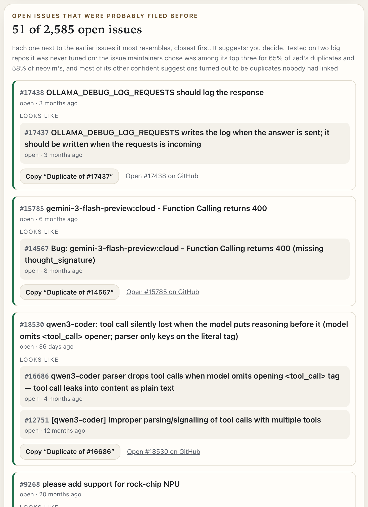
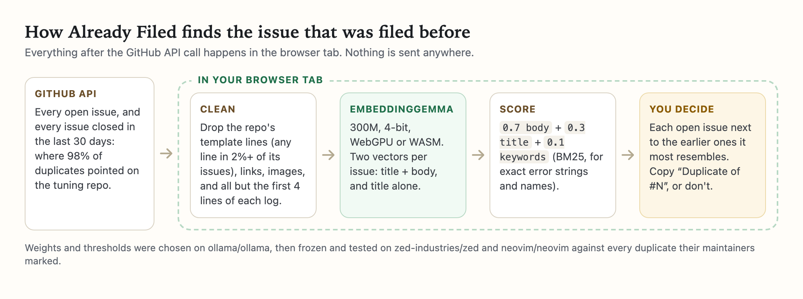

# IssueTwin 🦥

**Duplicate GitHub Issue and PR Finder.** Formerly called Already Filed.

Finds the open GitHub issues that say the same thing as an earlier one, so maintainers can type “Duplicate of #…” without remembering thousands of issues. And lets a reporter check before filing.

Point it at a repo. **EmbeddingGemma**, Google's open-weight embedding model, reads every open issue (and every one closed this month) in your browser, and the page lists the open issues that look like one filed before, with the comment ready to copy. Nothing is sent anywhere except the request to GitHub's public API for the issues.

It also does three more things:

- **Duplicate PRs.** Which open PRs fix an issue another PR already fixes (“#123 is already being fixed in PR #456”), and which repeat an earlier PR. [More](#duplicate-pull-requests)
- **Backlog sweep.** Groups the open duplicates, and closes the ones you tick with GitHub's own close-as-duplicate. Dry run by default. [More](#backlog-sweep)
- **A GitHub Action.** Leaves one quiet comment on a new issue or PR that looks like an earlier one. It edits that comment on reruns and never closes anything. [More](#github-action)

**Live:** https://vanshajpoonia.github.io/already-filed/ (free, and stays free)



## Why

Big repos get the same bug reported again and again. In zed-industries/zed, maintainers have linked **1,653 issues** to the issue they duplicate; the original was filed a median **1,343 issues (64 days) earlier**. Nobody remembers that far back, so every duplicate costs a maintainer a search, or a contributor's time on an issue that is already being worked on elsewhere.

Pull requests repeat too. In meshery/meshery on 20 November 2026, **57 issues** had a second open PR fixing them while an earlier PR, open or merged, already did (the PR snapshot in `data/snapshots`).

## How it works



- **What gets searched.** On the tuning repo, 91% of the issues maintainers pointed to were still open when the duplicate was filed, and another 7% had been closed in the 30 days before. So each issue is compared with exactly that: issues open at the time, or closed in the last 30 days. It is also all the app needs to fetch.
- **Cleaning** (`src/text.js`). Issue templates make unrelated issues look alike (every ollama issue starts with “What is the issue?”, “OS”, “GPU”, “Ollama version”). Rather than hard-coding any repo's template, a line counts as template text when it appears in more than 2% of the repo's issues. Links, images and all but the first 4 lines of each log are dropped too: the first lines of a log are where the error is.
- **The prompt** (`src/embed.js`). EmbeddingGemma is told what the vectors are for. Its retrieval prompt, `task: search result | query:`, beat the "sentence similarity" prompt I started with by 10 points on the tuning repo's titles (51% against 41% top 3; `node scripts/prompts.mjs` compares five).
- **Three signals** (`src/match.js`). EmbeddingGemma's vector of the title and body (same problem, different words), its vector of the title alone (titles are where people name the bug), and keyword search (BM25) for exact error strings, flags and model names that an embedding blurs. The mix, `0.7 body + 0.3 title + 0.1 keywords`, was picked on the tuning repo from a small grid (`npm run tune`).
- **In the browser.** EmbeddingGemma runs through transformers.js on WebGPU, or WASM where there is none (with the build that keeps the token table unquantised, which the WASM runtime needs). The **ollama/ollama** button opens a snapshot read in advance by the same model (`scripts/snapshot.mjs`, 8-bit vectors), so the demo is instant; anything else is read live.

<a id="measured"></a>

## How well it works

| Right one in the top three | Duplicates | Keyword search | IssueTwin |
|---|---|---|---|
| zed-industries/zed issues | 1,653 | 38% | **65%** |
| neovim/neovim issues | 379 | 39% | **58%** |
| meshery/meshery PRs a maintainer called a duplicate | 83 | 80% | **84%** |
| meshery/meshery PRs for an issue an earlier PR fixes, links taken out | 392 | 86% | **90%** |

Every issue of each repo is replayed in the order it was filed. For each issue a maintainer later linked as a duplicate, the question is whether the issue it duplicates is among the first three suggestions. Keyword search is BM25, roughly what GitHub's search box does. The ranking was not tuned on any of these repos. PRs are replayed the same way, and the gap over keyword search is much smaller there: see [duplicate pull requests](#duplicate-pull-requests-measured). To rerun it:

```bash
npm install
npm test     # the first run embeds ~38,000 issues and 7,400 PRs, then it is cached
```

The rest of this section is how those numbers were made. Every number here comes from `npm test`. The data is a frozen snapshot of every issue in three repos (`data/repos`, fetched with `npm run fetch`), with the duplicate links maintainers made: “Duplicate of #123” or GitHub's close-as-duplicate leaves a `MarkedAsDuplicateEvent`, and that is the ground truth. Issues are replayed in the order they were filed; for each one later marked a duplicate, the question is whether the issue it duplicates (or an earlier duplicate of the same one) is among the suggestions.

Everything was chosen on **ollama/ollama** (11,478 issues, 681 linked duplicates) and then frozen. The test repos were not looked at until then.

How the method got there, on the tuning repo (`npm run tune`):

| ollama/ollama (tuning), 681 duplicates | Top 1 | Top 3 | Top 5 |
|---|---|---|---|
| Keyword search (BM25), every earlier issue | 27% | 38% | 44% |
| EmbeddingGemma, "sentence similarity" prompt, every earlier issue | 29% | 42% | 48% |
| ...only issues open then, or closed in the last 30 days | 33% | 49% | 56% |
| ...with the "search result" prompt | 44% | 61% | 66% |
| ...plus the title vector and keywords (shipped) | **46%** | **65%** | **72%** |

Then, frozen, on the test repos (`npm test`). Each new issue is compared with the issues open when it was filed, or closed in the 30 days before:

| zed-industries/zed (test), 1,653 duplicates | Top 1 | Top 3 | Top 5 |
|---|---|---|---|
| Keyword search (BM25) | 25% | 38% | 43% |
| EmbeddingGemma alone | 44% | 62% | 69% |
| bge-small (a sixth of the size), same mix | 45% | 64% | 72% |
| **EmbeddingGemma mix (shipped)** | **45%** | **65%** | **72%** |

| neovim/neovim (test), 379 duplicates | Top 1 | Top 3 | Top 5 |
|---|---|---|---|
| Keyword search (BM25) | 26% | 39% | 45% |
| EmbeddingGemma alone | 42% | 59% | 64% |
| bge-small, same mix | 40% | 56% | 60% |
| **EmbeddingGemma mix (shipped)** | **43%** | **58%** | **64%** |

What the tables say:

- **Where you look matters as much as the model.** Comparing a new issue only with issues that were open at the time is worth 7 points on its own, because old closed issues are almost never the answer and there are thousands of them to be a near miss.
- **The prompt mattered more than the model.** Same weights, one line changed, 12 points on the tuning repo.
- **Embeddings beat keywords by a wide margin** on both test repos: the right issue is in the top three for 65% of zed's duplicates against 38%, and 58% of neovim's against 39%. Of the duplicates only one of them gets, 518 (zed) and 81 (neovim) are EmbeddingGemma's; 64 and 10 are keyword search's.
- **A much smaller model is almost as good** once the recipe is right: bge-small is within two points on ollama and zed, and two to four behind on neovim. EmbeddingGemma is ahead at top three on all three repos, which is why it ships; if 197 MB is too much for your users, the recipe is the part to copy.
- **The mix does not always help.** On neovim, EmbeddingGemma alone was as good as the mix (59% against 58% at top three, 42% against 43% at top one). The weights were fixed on ollama and I left them.
- **The thresholds are conservative.** “Likely” (chosen so 5% of never-linked issues on ollama would get one) shows the right issue for 12% of zed's duplicates while appearing on 4% of its other issues (neovim: 6% and 2%). Most of those are duplicates nobody linked: see below.

### Not every false alarm is false

Maintainers do not link every duplicate. Plenty are closed as “completed” with a comment, or never closed. So an issue with no link that gets a confident suggestion counts as a false alarm above, even when it is a duplicate. `node scripts/audit.mjs <repo> 30` prints 30 of them at random. Reading the 30 it prints for zed: **21 are the same problem** (two even have the same title, word for word), **9 are related** (same feature, a different bug: two Copilot problems in the agent panel, two MCP transport hangs with different triggers), and **none are unrelated**. That is my reading, not the maintainers', and every number above still counts all 30 as wrong.

### Duplicate pull requests, measured

Measured on **meshery/meshery**, where many contributors race to fix the same issue. `npm run fetch:prs meshery/meshery 2025-01-01` froze its 7,409 PRs filed since 2025, bots left out (`data/prs`). Two kinds of duplicate:

- **Called a duplicate.** A maintainer used GitHub's “Duplicate of #…”, or wrote “duplicate” or “superseded” next to the other PR's number. That gives 84 pairs, 83 of them inside the window. By my reading 75 of the 84 are clearly the same change and 9 look wrong or unclear, like #19414 “Remove dead copilot-pr-handler workflow” against #19413 “Display catalog designs on model pages”. All 84 count as right answers.
- **Same issue.** A PR fixes an issue that an earlier PR, still open or already merged, also fixes. There are 392.

Each new PR is compared with the PRs open when it was filed, or closed in the 30 days before. The issue recipe is used frozen: same prompt, same mix, same cleaning. Every “fixes #N” is taken out of the text, so the text is judged on its own (`node tests/pr-eval.mjs`).

| meshery/meshery, 83 PRs called a duplicate | Top 1 | Top 3 | Top 5 |
|---|---|---|---|
| Keyword search (BM25) | 66% | 80% | 82% |
| EmbeddingGemma alone | 67% | 78% | 81% |
| **EmbeddingGemma mix (shipped)** | **69%** | **84%** | **84%** |
| Links first, then the mix (what the page and the Action show) | | **88%** | |

| meshery/meshery, 392 PRs for an issue an earlier PR fixes, links taken out | Top 1 | Top 3 | Top 5 |
|---|---|---|---|
| Keyword search (BM25) | 74% | 86% | 89% |
| EmbeddingGemma alone | 75% | 89% | 92% |
| **EmbeddingGemma mix (shipped)** | **78%** | **90%** | **93%** |

What the tables say:

- **The links do most of the work.** Every PR in the second table is found by its “fixes #N” link, and so are 39 of the 83 said duplicates (47%). Text adds the rest: links first, then the mix, puts the right PR in the top three for 88%.
- **On PRs the model is only a little better than keywords.** 84% against 80% on said duplicates is 3 PRs out of 83, too few to call. 90% against 86% on the same-issue PRs is 16 of 392. Duplicate PRs often share exact titles, function names and file paths, which keyword search is good at. EmbeddingGemma alone is behind keyword search on said duplicates.
- **It is one repo.** The PR numbers and thresholds come from meshery only.

The thresholds follow the issue rule, on the first half of the PRs: “likely” where 5% of the PRs never called a duplicate would get a suggestion (1.069), “maybe” where 20% would (0.889). On the second half:

| meshery/meshery, second half | Said duplicates shown | Same-issue PRs shown | Other PRs flagged |
|---|---|---|---|
| Likely, 1.069 | 7% | 6% | 2% |
| Maybe, 0.889 | 59% | 65% | 19% |

The 5% line for meshery's PRs sits at 1.069, far above the 0.907 found for ollama's issues. PRs from one repo look much more alike. So the strict line is very strict: text alone rarely passes it, and the Action's comments on PRs come mostly from links. The page also shows the “maybe” list. As with issues, many of those “other PRs” are duplicates nobody called out. `node scripts/audit.mjs meshery/meshery 20 0.889 prs` prints 20 at random. Reading them: **11 are the same change**, usually a closed PR redone as a new one, like #17658 and #17629, both “Expose organization command”. **8 are related**: consecutive version bumps, attendance PRs for different weeks, the same cleanup on other pages. **1 is unclear.** That is my reading, and the numbers above still count all 20 as wrong.

## Duplicate pull requests

Pick “Pull requests” on the page. It fetches the open PRs, and those closed or merged in the last 30 days, then shows two lists:

- **Issues with more than one PR.** From the issues each PR says it fixes: GitHub's closing keywords (“fixes #123”, “closes owner/name#123”, a full issue link), plus the links made in the sidebar when you add a token, which GitHub only gives through GraphQL. The oldest PR is first. A merged PR counts as already fixing it; a closed one does not.
- **PRs that look like an earlier one.** The issue recipe on the title and description, with every “fixes #N” taken out so the text alone is judged. Pairs already in the first list are left out.

Bots (Dependabot, Renovate and other `[bot]` accounts) are left out of both. The **meshery/meshery** button opens a snapshot read in advance.

## Backlog sweep

Under the issue results. The open issues that likely duplicate an earlier one are grouped, and each group starts with its oldest issue that was not itself closed as a duplicate. Tick the ones to close.

- **Dry run is on by default.** It shows the exact requests and sends nothing.
- To close for real, turn it off and paste a [fine-grained token](https://github.com/settings/personal-access-tokens/new) with Issues: Read and write on that repo. The token is kept in the tab's memory only. It is never saved and goes only to api.github.com. Then confirm.
- Each ticked issue gets one request, the way [GitHub's REST docs](https://docs.github.com/en/rest/issues/issues#update-an-issue) describe closing as a duplicate: `PATCH /repos/{owner}/{repo}/issues/{n}` with `state: "closed"`, `state_reason: "duplicate"` and `duplicate_issue_id`, the original's id (not its number). They go one at a time, and it stops if GitHub refuses the token.

## GitHub Action

Leaves one comment on a new issue or PR when it looks like an earlier one, in the same words as the page. On a rerun it edits that comment, or says it no longer finds anything, and never posts a second. It never closes, labels or reopens anything. EmbeddingGemma runs on the runner through transformers.js. The model (197 MB) and the vectors of earlier issues are cached, so later runs only embed what is new.

```yaml
# .github/workflows/issuetwin.yml
name: IssueTwin
on:
  issues:
    types: [opened, reopened]
  pull_request_target:          # so PRs from forks can get a comment; the PR's code is never checked out
    types: [opened, reopened]
permissions:
  issues: write
  pull-requests: write
jobs:
  check:
    runs-on: ubuntu-latest
    steps:
      - uses: VanshajPoonia/already-filed@v1
        with:
          threshold: ''       # issues: 0 to 1, empty for the benchmarked default (0.907)
          pr-threshold: ''    # PRs: the same, default 1.069
          dry-run: 'false'    # 'true' only prints the comment in the log
```

| Input | Default | What it does |
|---|---|---|
| `token` | `github.token` | Reads issues and PRs, writes the one comment |
| `threshold` | 0.907 | How close an earlier issue has to score to be mentioned. Higher means fewer, surer comments |
| `pr-threshold` | 1.069 | The same for PRs. On PRs text alone rarely passes it, so comments come mostly from links. 0.889 catches about 60% of repeats and flags about one other PR in five, about half of them repeats nobody called out ([measured](#duplicate-pull-requests-measured)) |
| `dry-run` | `false` | Print the comment instead of posting it |

Outputs: `comment` (posted, edited, unchanged, none, would-post or would-edit) and `matches` (the numbers mentioned). `node tests/action.mjs` runs it against fixtures, real zed issues and meshery PRs, with the real model and a fake GitHub that records every write.

## Limits

- It suggests; it does not close anything. Some pairs share an error message but not a cause (“exit status 2” has many causes). A maintainer still decides.
- Feature requests are easier than bugs: two people asking for the same thing use the same words.
- Without a token, GitHub allows 60 API requests an hour per network. A repo with 2,500 open issues needs about 30. A fine-grained token with no permissions lifts it; it stays in the tab and goes only to api.github.com.
- English-centred: EmbeddingGemma is multilingual, but the thresholds were chosen on English issues.
- PR links without a token come from the PR text only. Links made in the sidebar need a token, because GitHub only gives them through GraphQL.
- The PR numbers come from one repo, meshery/meshery, and its duplicate labels come from what maintainers wrote in comments. The gap over keyword search is small on PRs.

## Run it

```bash
npm start              # static server on :8000, no build step
npm install            # only for the scripts and tests
npm test               # unit checks, the Action on fixtures, the test repos, then duplicate PRs
npm run tune           # the choices made on ollama/ollama
REPOS=ollama/ollama node tests/eval.mjs   # the tuning repo through the same test
node scripts/audit.mjs zed-industries/zed 30
GITHUB_TOKEN=... npm run fetch owner/name # snapshot another repo's issues
GITHUB_TOKEN=... npm run fetch:prs owner/name 2025-01-01  # and its PRs since a date
PR_REPOS=owner/name node tests/pr-eval.mjs                # the PR test on it
THREADS=4 npm test                                        # fewer CPU threads for the first, slow run
node scripts/audit.mjs meshery/meshery 20 0.889 prs       # PR "false alarms" to read
node scripts/snapshot.mjs meshery/meshery prs             # the instant PR demo
```

The first test run embeds every issue in both test repos and every meshery PR, and takes a while (about two hours on an M4, plus half an hour for the PRs). Vectors are cached in `tests/.cache`, saved every 1,000 texts, so a stopped run picks up where it left off.

## Files

```
src/text.js          what part of an issue is compared (template, links, logs)
src/embed.js         the embedding models (shared by the browser and the scripts)
src/bm25.js          keyword search
src/match.js         the mix of signals, and which issues are searched
src/threshold.js     when a suggestion is "likely" or "maybe", chosen on ollama/ollama
src/github.js        open and recently closed issues and PRs from GitHub's API
src/prs.js           which issues a PR fixes, PRs for the same issue, the text a PR is compared by
src/sweep.js         the backlog sweep: groups, and GitHub's close-as-duplicate requests
src/model.js         EmbeddingGemma in the browser (WebGPU, or WASM)
src/app.js           UI
action.yml           the GitHub Action
action/check.mjs     what it does for one new issue or PR
action/run.mjs       its entry point: event, model, cache
action/vectors.mjs   vectors kept between runs
scripts/fetch.mjs    freezes a repo's issues and duplicate links into data/repos
scripts/fetch-prs.mjs freezes a repo's PRs and the duplicates maintainers called out into data/prs
scripts/tune.mjs     every choice made on the tuning repo
scripts/audit.mjs    prints "false alarms" to read, for issues or PRs
scripts/snapshot.mjs the instant demos in data/snapshots
tests/unit.mjs       fast checks, no model
tests/action.mjs     the Action against fixtures, with the model and a fake GitHub
tests/eval.mjs       the test repos
tests/pr-eval.mjs    duplicate PRs
```

## Credits

Model: [EmbeddingGemma](https://huggingface.co/google/embeddinggemma-300m) by Google, under the [Gemma Terms of Use](https://ai.google.dev/gemma/terms), [ONNX build](https://huggingface.co/onnx-community/embeddinggemma-300m-ONNX). Comparison model: [bge-small-en-v1.5](https://huggingface.co/BAAI/bge-small-en-v1.5) (MIT). Runtime: [transformers.js](https://github.com/huggingface/transformers.js) and ONNX Runtime Web. Test data: public issues of [ollama/ollama](https://github.com/ollama/ollama), [zed-industries/zed](https://github.com/zed-industries/zed) and [neovim/neovim](https://github.com/neovim/neovim), and public pull requests of [meshery/meshery](https://github.com/meshery/meshery), from GitHub's API.

Code: MIT licence.
